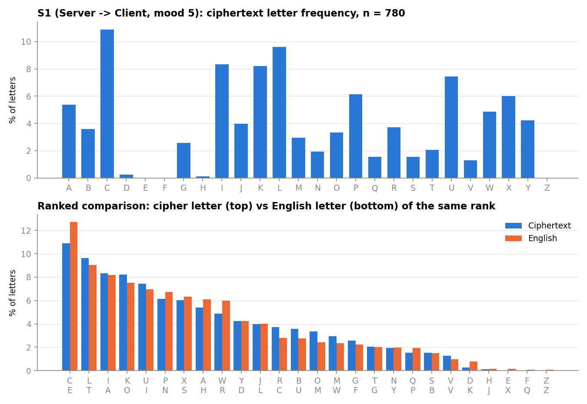
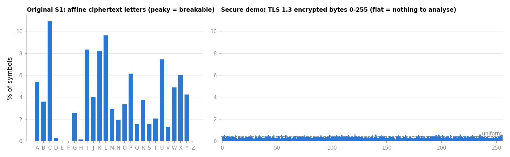

# Breaking PsycoSupport

Classical cryptanalysis of an LLM-backed client–server app: capturing its "encrypted" traffic, breaking the affine cipher with Al-Kindi frequency analysis, rebuilding the server from the recovered protocol, and fixing the design with TLS 1.3 and UNIX domain sockets.

- **Problem statement:** [problem_statement.pdf](problem_statement.pdf)
- **Full report (25 pages):** [report/report.pdf](report/report.pdf)
- **Target application:** [maadilrehman/PsycoSupport](https://github.com/maadilrehman/PsycoSupport) (pre-built Linux `client` / `server`, no source)

## Results

All 10 captured ciphertexts (5 per direction) were decrypted from the ciphertext alone.

| Mood | Key (a, b) | a⁻¹ mod 26 | Decryption |
|---:|:---:|:---:|---|
| 2 | (5, 4) | 21 | D(y) = 21(y − 4) mod 26 |
| 5 | (11, 10) | 19 | D(y) = 19(y − 10) mod 26 |
| 8 | (17, 16) | 23 | D(y) = 23(y − 16) mod 26 |
| 10 | (21, 20) | 5 | D(y) = 5(y − 20) mod 26 |

- **Key schedule:** `a = 2·mood + 1`, `b = 2·mood (mod 26)`, the same in both directions. The mood is sent in **plaintext**, so the key is effectively public.
- **Server → Client:** plain affine cipher on upper-case letters, spaces kept.
- **Client → Server:** every character is written as two hex digits, and each digit (0–15) is then affine-encrypted. That is why only 13–14 distinct cipher letters ever appear.
- **Known plaintext for free:** every reply starts with the username (`FAATEH …`). Two letters are enough to solve for the key.
- **Validation:** a [re-implemented `server.py`](server/server.py) built only from the recovered protocol works with the original, unmodified client, including at a mood that was never captured.



## How it works

1. **Offline deployment.** Ollama + `llama3.2` on Ubuntu (WSL2). The original server calls a retired Groq model, so [`scripts/relay.py`](scripts/relay.py) redirects its Groq API calls to Ollama without modifying the binary (`GROQ_BASE_URL=http://127.0.0.1:8000 ./server`).
2. **Interception.** `tcpdump -i lo 'tcp port 9999'` while five sessions are sent ([evidence/](evidence/)).
3. **Extraction.** [`scripts/extract_ciphertexts.py`](scripts/extract_ciphertexts.py) reassembles the TCP streams into [`ciphertexts.csv`](ciphertexts.csv).
4. **Frequency analysis.** [`scripts/frequency_analysis.py`](scripts/frequency_analysis.py) produces the tables and charts in [output/](output/).
5. **Key recovery.** [`scripts/crack_keys.py`](scripts/crack_keys.py) maps the top cipher letters to E/T/A/O/I/N, solves the congruences (extended Euclid for the inverses), scores the candidates with χ², and confirms with an exhaustive 312-key search. The working is in [output/key_derivation.md](output/key_derivation.md), the decryptions in [output/decryptions.md](output/decryptions.md).
6. **General decryptor.** [`scripts/decrypt.py`](scripts/decrypt.py) decrypts any message, for either direction and any mood (it searches for the key if the mood is unknown).

## Fixing it

[`secure_demo/`](secure_demo/) runs the same exchange over **TLS 1.3** (self-signed certificate pinned by the client, TLS 1.2 refused) and over a **UNIX domain socket** (`0600`). Running the same attack again:

| | Original (port 9999) | TLS 1.3 demo |
|---|---|---|
| Structure visible | JSON keys, `"mood": N` | none |
| Shannon entropy | 4.18 bits/letter (English ≈ 4.1) | 7.96 bits/byte (max 8) |
| Frequency analysis | key recovered | nothing to map |

The UNIX-socket exchange never appears on the wire at all. One caveat: Ollama passes prompts to its internal model runner over plain HTTP on loopback, so **every hop carrying patient data needs protecting**, not just client ↔ server.



## Repository layout

```
problem_statement.pdf   what was set out to do
ciphertexts.csv         the 10 captured ciphertexts
scripts/                relay, extraction, frequency analysis, key recovery, decryptor, shared affine maths
server/server.py        PsycoSupport server re-implemented on a local Ollama backend
secure_demo/            TLS 1.3 and UNIX-socket implementation, demo and capture analysis
evidence/               screenshots and packet captures (capture.pcap, secure_capture.pcap)
output/                 generated tables, charts, key derivation and decryptions
report/                 LaTeX sources and the compiled report
```

## Reproduce

```bash
# analysis (Python 3 + matplotlib)
python scripts/extract_ciphertexts.py evidence/capture.pcap ciphertexts.csv
python scripts/frequency_analysis.py ciphertexts.csv output
python scripts/crack_keys.py ciphertexts.csv output
python scripts/decrypt.py --csv ciphertexts.csv

# run the re-implemented server (Linux, Ollama running with llama3.2), then the original ./client
python3 server/server.py

# secure demo (Linux)
bash secure_demo/run_demo.sh
```

The report is built with [Tectonic](https://tectonic-typesetting.github.io/): `tectonic report/report.tex`.

## Ethics

Everything here was done on my own machine, against my own instance of the application, over the loopback interface, with synthetic messages and a dummy API key. Intercepting the traffic of real applications or users without authorisation is unethical and illegal.
